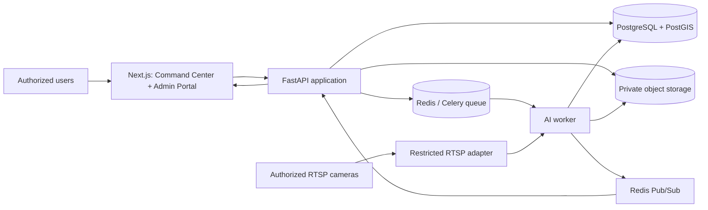
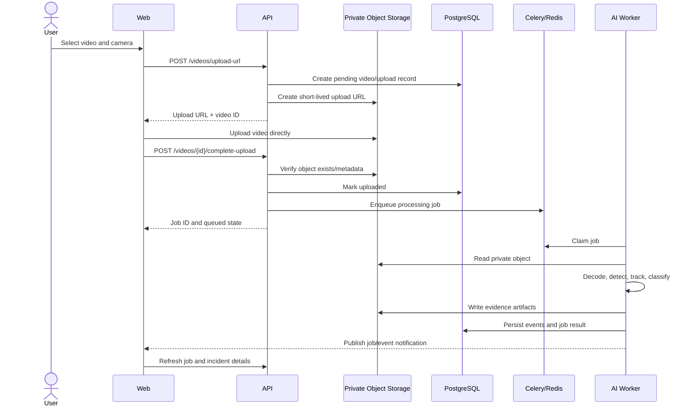
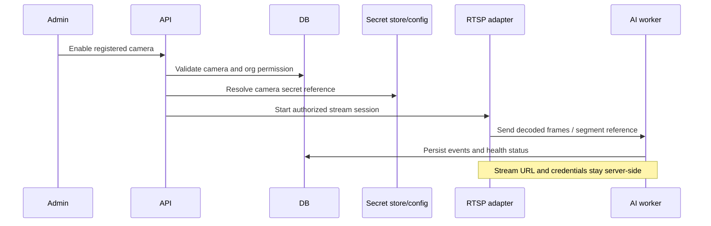

# System Architecture and Integration Design

**Version:** 1.0  
**Status:** Prototype baseline

## 1. Architectural style

Use a **modular monolith for business APIs plus an independently deployed asynchronous AI worker**. This gives the team clear module boundaries without creating unnecessary distributed-system overhead.

Logical modules:

1. Identity and organization management
2. Camera and video registry
3. Video ingestion and job orchestration
4. Computer-vision detection and tracking
5. Event classification and evidence generation
6. Historical accident and hotspot analytics
7. Asset/department/contract registry
8. Investigation and recommendation workflow
9. Work orders and verification
10. Audit and notification delivery

## 2. Context diagram



## 3. Video upload sequence



## 4. Live CCTV sequence



For the hackathon, the adapter may replay a supplied demo clip. Its status and UI label must explicitly say **simulated live**. A true RTSP source is enabled only after authorization, allowlisting and network access are configured.

## 5. Domain event envelope

All asynchronous notifications should use a common envelope:

```json
{
  "event_id": "uuid",
  "event_type": "incident.detected",
  "occurred_at": "2026-11-18T08:30:00Z",
  "organization_id": "uuid",
  "resource_type": "incident",
  "resource_id": "uuid",
  "schema_version": "1.0",
  "data": {
    "incident_type": "near_miss_candidate",
    "review_status": "pending"
  }
}
```

The WebSocket gateway must construct or filter this envelope using authenticated organization context. The client must not subscribe by supplying an arbitrary organization ID.

## 6. Data ownership and source of truth

| Data | Authoritative owner |
|---|---|
| Users, organizations and roles | Identity module/database |
| Camera metadata | Camera registry |
| Video file bytes | Private object storage |
| Video metadata and job state | API database |
| Raw detections and potential events | AI worker output persisted to database/object storage |
| Human incident review | Incident workflow module |
| Historical accident record | Imported/source record with provenance |
| Asset/department/contract relationship | Registry records supplied by authorized administrator/source |
| Recommendation approval | Authorized human reviewer |
| Work-order status and verification | Workflow module |
| Audit events | Append-only audit subsystem |

## 7. Failure handling

| Failure | Expected behaviour |
|---|---|
| Upload interrupted | Keep upload incomplete; allow safe retry or restart; do not enqueue processing |
| Unsupported/corrupt video | Mark validation/processing failure with actionable message |
| Worker crash | Job remains retryable; use lease/visibility timeout and idempotency key |
| AI model unavailable | Job fails safely; show service error; do not fabricate events |
| MinIO unavailable | Reject upload/process attempt or retry transient storage operation |
| RTSP disconnected | Set camera health state to disconnected; reconnect with bounded backoff |
| WebSocket unavailable | UI falls back to REST polling/manual refresh |
| LLM provider unavailable | Preserve deterministic facts/workflow; allow manual investigation and recommendation entry |
| No location metadata | Keep event location unknown; do not infer camera coordinates unless a registered camera association exists |

## 8. Deployment topology

### Hackathon/local

- Docker Compose services: web, API, worker, PostgreSQL/PostGIS, Redis, MinIO.
- One developer machine can run all services; GPU-enabled worker is optional.
- Seed synthetic data on startup or using an explicit seed command.

### Future controlled pilot

- Private network, managed PostgreSQL/PostGIS, private object storage, managed queue, secret manager, TLS, centralized logs, backup/restore, access review and retention controls.
- RTSP ingestion isolated in a restricted network segment.
- No public ingress to camera networks.
- Production deployment requires a separate security, privacy, operational and legal review.

## 9. Scalability path

Do not prematurely split the API into microservices. If later required, extract video orchestration/AI workers, notification delivery or analytics behind the existing API contracts. Preserve stable event and database contracts during extraction.
