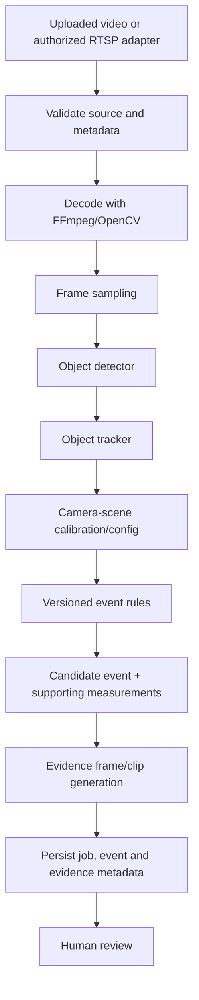

# AI and Computer-Vision Pipeline Specification

**Version:** 1.0  
**Status:** Prototype baseline

## 1. Purpose and safety boundary

The AI pipeline converts authorized footage into structured, reviewable observations. It is not an autonomous accident investigator. Computer vision can miss events and generate false positives. Outputs must be labelled as candidate observations until a human review is completed.

## 2. MVP pipeline overview



## 3. Input contract

Required video metadata:

- `video_id`, `organization_id`, object-storage reference.
- `source_type` (`upload`, `rtsp_recording`, `demo_replay`).
- Camera ID if known.
- Recorded timestamp if known; otherwise mark unknown.
- Media metadata: duration, resolution, frame rate, codec and file size.
- Optional camera scene configuration: road direction, region-of-interest polygons, stop-line/signal regions, calibration metadata.

Do not infer recording time from upload time. Keep these fields distinct.

## 4. Stage A — validation and decoding

1. Validate object ownership and tenant access.
2. Validate file size and allowed media container/type.
3. Inspect with FFprobe.
4. Reject corrupt, unsupported or excessively large files safely.
5. Decode using FFmpeg/OpenCV.
6. Preserve original frame timestamps/time offsets where possible.
7. Sample frames at a configurable rate to balance performance and detection quality.
8. Record decode warnings, dropped frames and processing duration.

A five-frames-per-second sample rate is a starting configuration, not a universal rule. It may miss short events. Choose rate based on demo clip frame rate, model speed and event duration, and record it in job config.

## 5. Stage B — object detection

Use a pretrained model adapter, initially YOLO-compatible. Supported classes depend on the selected weights; define an explicit class map and do not assume the model has every target class.

Minimum demo classes if supported by weights:

- person
- bicycle
- motorcycle
- car
- bus
- truck

For each detection persist or retain for analysis:

- frame number and timestamp offset
- class ID and class label
- bounding box in source-frame coordinates
- raw model score
- model identifier/version and preprocessing configuration

Thresholds must be configurable. A model score is not a calibrated probability that the event is true.

## 6. Stage C — multi-object tracking

Use a ByteTrack-compatible adapter or another validated tracker. Maintain track IDs across frames where possible. Record when tracks start/end and handle ID switches. A track ID is local to a processing job; do not treat it as a persistent identity of a person or vehicle.

Do not infer identity, ownership, a driver's name or vehicle registration.

## 7. Stage D — camera configuration and geometry

Camera perspective makes pixel distances different from physical distances. Before using physical measures:

- Define a camera-specific region of interest.
- Define road travel direction/lanes where known.
- Calibrate image-to-road-plane mapping using known reference points or a documented calibration procedure.
- Store calibration version and uncertainty.

Without calibration, describe quantities as image-plane proximity, image displacement or trajectory overlap. Do not report km/h, metres, collision probability or physical time-to-collision from uncalibrated pixels.

## 8. Stage E — event rules

Implement each event as a separately versioned rule with configuration and evidence.

### E-01 Near-miss candidate (recommended first event)

Possible ingredients:

- Two tracked road users move into a configured conflict region.
- Their projected paths converge within a configurable time window.
- Image-plane proximity becomes small relative to configured object/scene scale.
- One or both tracks show an evasive change in trajectory or speed proxy, where detectable.

Output: `near_miss_candidate`, rule version, track IDs, frame/time window, proximity/trajectory features, thresholds, score/reason codes and limitations.

This is a heuristic candidate, not proof that a collision nearly occurred. Validate on selected demo clips before enabling it in the main demonstration.

### E-02 Wrong-way candidate

Requires a configured expected road direction and a track with sufficient movement. Without camera/road configuration, mark unavailable. Do not infer road direction from an arbitrary clip with no calibration.

### E-03 Sudden-deceleration candidate

Requires calibrated speed or a documented image-motion proxy. In uncalibrated footage use a weaker `rapid_motion_change_candidate` label, not a definitive sudden-braking claim.

### E-04 Signal-line crossing candidate

Requires known signal state synchronized to the footage, configured stop line and correct camera geometry. Do not infer signal state from pixel colour alone unless a validated signal-state module exists.

### E-05 Collision candidate

Possible visual overlap and abrupt post-event motion changes may generate a candidate. Bounding-box overlap alone is insufficient. Use the label `collision_candidate` and require human review.

### E-06 Pedestrian-vehicle conflict candidate

Requires person and vehicle tracks, a defined crossing/conflict region and suitable camera geometry. State limitations and avoid identifying the person.

## 9. Event output contract

```json
{
  "event_type": "near_miss_candidate",
  "source_kind": "ai_candidate",
  "video_id": "uuid",
  "camera_id": "uuid-or-null",
  "event_start_offset_seconds": 42.5,
  "event_end_offset_seconds": 48.0,
  "track_ids": [12, 15],
  "model": {"name": "configured-detector", "version": "recorded-version"},
  "rule": {"name": "near_miss_v1", "version": "1.0.0"},
  "model_score": 0.84,
  "features": {
    "minimum_image_plane_distance": 18.2,
    "trajectory_conflict": true,
    "evasive_motion_proxy": true
  },
  "reason_codes": ["TRAJECTORIES_CONVERGED", "LOW_IMAGE_PLANE_DISTANCE"],
  "limitations": ["CAMERA_NOT_METRIC_CALIBRATED"],
  "review_status": "pending"
}
```

The values are illustrative. `model_score` is not automatically a calibrated event probability. Store source coordinates separately from camera location. Only attach camera coordinates when the video is reliably associated with that registered camera.

## 10. Evidence generation

For every candidate event:

- Store start/end offsets in the source video.
- Generate one or more annotated frames with bounding boxes and track IDs (job-local).
- Optionally generate a short clip around the event.
- Save SHA-256 checksum, content type, size and storage key.
- Preserve source video reference and processing configuration.
- Ensure all evidence access is private and permission-checked.
- Avoid unnecessary retention of full-resolution frames.

A screenshot/clip is supporting context, not definitive proof of causation.

## 11. Stage F — hotspot and risk analysis

Keep datasets and labels separate:

1. Verified historical accident records.
2. Human-confirmed camera observations.
3. Pending AI event candidates.
4. Near-miss candidates.
5. Manual road-inspection defects.

For the MVP:

- Use PostGIS proximity queries or DBSCAN on valid coordinates.
- Aggregate by configurable location radius, time window and event category.
- Display counts and source categories independently.
- If traffic exposure is unavailable, call the output “event concentration” or “observed incident concentration”, not an exposure-normalized risk rate.
- Show methodology, date window, data source and generated timestamp.
- Exclude unknown/low-quality location records from spatial clusters or show them in an unlocated bucket.

Potential later measure: exposure-adjusted rate = reviewed events / traffic exposure for the same road/time window, with units and source documented. Do not calculate if exposure is unavailable or incomparable.

## 12. Infrastructure and responsibility matching

The responsibility engine is rule-based, not an LLM decision.

Input:

- Selected asset and geospatial match details.
- Asset ownership/maintenance department.
- Contract scope, dates, asset linkage and warranty details.
- Source records and validity timestamps.

Output:

- matched asset ID and match method/distance
- department record ID
- relevant contract IDs and date/scope matches
- missing/conflicting records
- source references
- verification status

Possible statuses: `matched_records`, `ambiguous_match`, `no_asset_match`, `missing_contract_data`, `requires_field_verification`.

Do not automatically state that a department or contractor caused an accident or is legally liable.

## 13. LLM investigation assistant

LLM use is optional and must be behind a provider interface. The application must remain functional if no API key is configured.

Permitted tasks:

- Summarize structured observations and source records.
- Draft hypotheses explicitly labelled as hypotheses.
- Identify missing evidence and questions for an inspector.
- Draft possible interventions drawn from approved categories.
- Draft plain-language report text.

Prohibited tasks:

- Declare legal or contractual liability.
- Identify a driver/person from footage.
- Fabricate asset or contract relationships.
- Claim a defect caused an accident without supporting evidence.
- Invent confidence values or citations.
- Issue an official notice or create an approved work order without human approval.

Structured response schema:

```json
{
  "observed_facts": [],
  "potential_root_causes": [
    {"hypothesis": "...", "supporting_record_ids": [], "counter_evidence": [], "confidence_label": "low|medium|high"}
  ],
  "missing_information": [],
  "potentially_relevant_authorities": [],
  "recommended_actions": [
    {"action": "...", "rationale": "...", "priority": "low|medium|high", "requires_human_approval": true}
  ],
  "limitations": [],
  "human_verification_required": true
}
```

Validate output against a schema. Treat model output as untrusted text; escape rendered content and never execute model-generated SQL, code or URLs.

## 14. Model evaluation and acceptance

Before the demo, select representative sample clips and manually annotate expected objects/events. Report:

- detector class/score behaviour on those clips
- tracker continuity observations
- false-positive examples
- missed-event examples
- processing throughput on target machine
- known camera-angle/lighting limitations

Do not claim general accuracy from a handful of demo clips. Use qualitative demo validation if no statistically meaningful labelled dataset exists.

## 15. Versioning and reproducibility

Each job must capture:

- detector library/model/weights identifier and checksum
- class map
- preprocessing/frame sampling settings
- tracker name/version/config
- event-rule names/versions/thresholds
- camera calibration version if used
- AI worker build/version

Reprocessing creates a new job record, not an overwrite of previously reviewed output.
