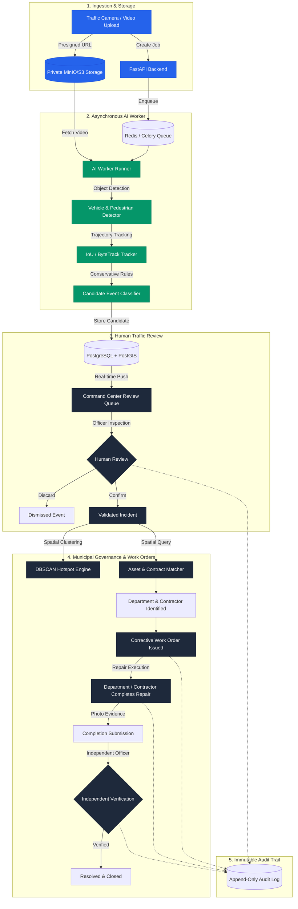

# 🏙️ Nagar-Setu (नगर सेतु) | ROADGUARD AI

<p align="center">
  <strong>Next-Generation AI Road-Safety Intelligence & Municipal Corrective-Action Governance Platform</strong>
</p>

<p align="center">
  <em>Bridging the critical gap between traffic surveillance computer vision, infrastructure asset registries, and municipal engineering accountability.</em>
</p>

<p align="center">
  
  
  
  
  
  
  
</p>

---

## 📑 Table of Contents
- [Executive Overview](#-executive-overview)
- [The Dual-Interface Architecture](#-the-dual-interface-architecture)
- [End-to-End Governance Lifecycle](#-end-to-end-governance-lifecycle)
- [Responsible AI & Ethics Guardrails](#-responsible-ai--ethics-guardrails)
- [System Architecture & Data Flow](#-system-architecture--data-flow)
- [Technology Stack](#-technology-stack)
- [Repository Structure](#-repository-structure)
- [Quickstart Guide](#-quickstart-guide)
  - [Option A: Full Container Stack (Recommended)](#option-a-full-container-stack-recommended)
  - [Option B: Bare-Metal Development Setup](#option-b-bare-metal-development-setup)
- [Pre-Configured Demo Accounts](#-pre-configured-demo-accounts)
- [5-Minute End-to-End Demo Script](#-5-minute-end-to-end-demo-script)
- [Enterprise Security & Multi-Tenancy (RLS)](#-enterprise-security--multi-tenancy-rls)
- [Verification & Quality Assurance](#-verification--quality-assurance)
- [API Reference](#-api-reference)
- [Implementation Status & Roadmap](#-implementation-status--roadmap)

---

## 🌟 Executive Overview

In modern urban centers, traffic safety data is severely fragmented. Video surveillance feeds record near-misses and collisions, yet this data remains locked within police archives or traffic control rooms. Meanwhile, municipal departments (Public Works, Road Maintenance, Electrical) operate in separate silos, unaware of high-risk roadway hazards until formal citizen complaints or fatal accidents occur.

**Nagar-Setu (नगर सेतु — "City Bridge")** solves this disconnect by establishing a unified, transparent, and auditable pipeline connecting:
1. **Surveillance & Ingestion:** Authorized traffic camera streams and recorded footage.
2. **Explainable AI Telemetry:** Detection, IoU trajectory tracking, and conservative safety event classification.
3. **Civic Responsibility Matching:** Real-time linkage of incident locations to municipal asset registers, maintaining departments, and active vendor contracts.
4. **Enforced Corrective Action:** Complete work-order dispatch, photo-backed repair completion, independent verification, and immutable audit logging.

> **Key Premise:** AI proposes candidate observations; accountable human officials make every final governance and legal decision.

---

## 🌓 The Dual-Interface Architecture

Nagar-Setu delivers two distinct, role-specialized user experiences within a single unified Next.js application:

```
┌────────────────────────────────────────────────────────────────────────────────────────┐
│                                       NAGAR-SETU                                       │
├───────────────────────────────────────────┬────────────────────────────────────────────┤
│   🚨 COMMAND CENTER (Dark Theme)          │   🏛️ ADMINISTRATIVE PORTAL (Light Theme)   │
│   Tailored for Police & Traffic Ops       │   Tailored for Municipal Authorities       │
├───────────────────────────────────────────┼────────────────────────────────────────────┤
│ • Interactive GIS Overview Dashboard      │ • Municipal Department Directory           │
│ • Camera & Stream Registry (CCTV / RTSP)  │ • Road Contractor & Vendor Directory       │
│ • Secure Video Upload & Processing Queue  │ • Infrastructure Asset Registry (PostGIS)  │
│ • Candidate Event Review Queue (CV BBox)  │ • Maintenance Contract Validity Monitor    │
│ • Geospatial Hotspot Map (DBSCAN Cluster) │ • Cross-Departmental Investigations        │
│ • Spatial Incident Investigation Cases    │ • Corrective Work Order Dispatch & Tracking│
│ • Real-time Telemetry & Live Incident Feed│ • Verification Desk (Separation of Duties) │
│                                           │ • Append-Only System Audit Trail & Logs    │
└───────────────────────────────────────────┴────────────────────────────────────────────┘
```

---

## 🔄 End-to-End Governance Lifecycle



---

## 🛡️ Responsible AI & Ethics Guardrails

Nagar-Setu strictly adheres to ethical AI principles for public surveillance:

1. **Observations, Not Accusations:**
   The AI model generates **candidate observations** (`near_miss_candidate`, `collision_candidate`, `pedestrian_conflict_candidate`). It **never** issues legal findings of fault, guilt, or negligence.
2. **No Uncalibrated Pixel Physics:**
   Physical vehicle speeds are **never derived** from 2D uncalibrated perspective cameras. Detections explicitly declare limitations:
   - `CAMERA_NOT_METRIC_CALIBRATED`
   - `IMAGE_PLANE_MEASUREMENT_ONLY`
   - `CANDIDATE_OBSERVATION_NOT_CONFIRMED_EVENT`
3. **Data Provenance & Segregation:**
   Historical traffic police crash statistics are stored with strict provenance metadata and kept completely distinct from real-time AI-detected observations.
4. **Zero Automated Enforcement:**
   No automated fines, penalties, or public disclosures are generated by the algorithm. Every actionable case requires human officer sign-off.
5. **Synthetic Demo Footage:**
   All default demo video files and seeds are completely synthetic (`DEMO`), ensuring zero violation of citizen privacy during development.

---

## 🏗️ System Architecture & Data Flow

Nagar-Setu uses a **Clean Modular Monolith** architecture for business transactions combined with an **asynchronous worker tier** for intensive computer-vision processing.

```
┌─────────────────────────────────────────────────────────────────────────────┐
│                          Web Tier (Next.js 16)                              │
│         Command Center (Dark)           Administrative Portal (Light)       │
│                  │                                    │                     │
│                  └───► Same-Origin API Proxy (/api) ──┘                     │
└──────────────────────────────────────┬──────────────────────────────────────┘
                                       │ HttpOnly JWT + CSRF Double-Submit
                                       ▼
┌─────────────────────────────────────────────────────────────────────────────┐
│                         API Tier (FastAPI App)                              │
│   • Identity & RBAC              • Incident & Review Engine                 │
│   • Camera & Stream Registry     • Hotspot Analytics (PostGIS)              │
│   • Video Ingestion & Signer     • Work Orders & Verification               │
│   • Audit Logging Service        • WebSocket Realtime Dispatcher            │
└───────────────────────┬───────────────────────────────┬─────────────────────┘
                        │                               │
        Database & Spatial (PostgreSQL 16)      Task Broker (Redis 7.4)
        • Row-Level Security (RLS)                      │ Celery Job Lease
        • PostGIS 3.4 Geography                         ▼
        • Append-Only Audit Triggers      ┌───────────────────────────────────┐
                        │                 │    AI Engine Worker (Python)      │
                        │                 │ • Detector Adapter (Synthetic/YOLO│
                        │                 │ • Trajectory Tracker (IoU)        │
                        ▼                 │ • Deterministic Safety Rule Engine│
        Private Storage (MinIO / S3) ◄────┤ • Evidence Clipping & Annotation  │
        • Short-lived presigned URLs      └───────────────────────────────────┘
        • Zero public bucket exposure
```

### Architectural Diagrams

| System Architecture | Entity Relationship Diagram | Component Layout |
|:---:|:---:|:---:|
| [View Diagram](DOCUMENTATIONS/SYSTEM%20ARCHITECTURE.png) | [View ERD](DOCUMENTATIONS/ENTITY%20RELATIONSHIP%20DIAGRAM.png) | [View Architecture](DOCUMENTATIONS/ARCHITECTURE.png) |

---

## 💻 Technology Stack

| Layer | Technologies & Frameworks | Description |
|:---|:---|:---|
| **Frontend** | Next.js 16 (App Router), React 19, TypeScript 5.7, Tailwind CSS 4, Leaflet, React-Leaflet | High-performance reactive interfaces with distinct light/dark themes and geospatial maps |
| **Backend API** | FastAPI 0.115+, Pydantic v2, SQLAlchemy 2.0, Alembic, Uvicorn | Strictly typed RESTful API with automated OpenAPI specifications and structured error responses |
| **Database & GIS** | PostgreSQL 16, PostGIS 3.4, GeoAlchemy2, Supabase (managed) | Relational schema with spatial indices (`GIST`), PostGIS geography types, and DB-enforced RLS. Runs on the bundled PostGIS container or Supabase; see [docs/SUPABASE.md](docs/SUPABASE.md) |
| **Task Queue** | Celery 5.4, Redis 7.4 (Alpine), Polling Worker Fallback | Distributed asynchronous task execution with heartbeat lease extension and idempotent claims |
| **Computer Vision** | OpenCV (cv2), NumPy, IoU Tracker, ByteTrack Adapter, YOLO Adapter | Video decoding, frame sampling, trajectory prediction, and candidate event classification |
| **Object Storage** | MinIO (Chainguard hardened image) / AWS S3 | Encrypted, private object storage accessed strictly via short-lived presigned URLs |
| **Containerization**| Docker 29+, Docker Compose v2 | Multi-stage Dockerfiles (`api`, `worker`, `web`) with automated health checks |

---

## 📂 Repository Structure

```
Nagar-Setu/
├── apps/
│   ├── api/                   # FastAPI Backend Application
│   │   ├── alembic/           # Database migration versions (Head: 837c7ef69730)
│   │   └── app/
│   │       ├── api/v1/        # 13 Modular REST Routers (Auth, Cameras, Videos, Incidents, etc.)
│   │       ├── core/          # Security, Config, Errors, Permissions, Audit, Rate Limiting
│   │       ├── db/            # Tenant session factory, RLS context, naming conventions
│   │       ├── models/        # SQLAlchemy domain entities (Identity, Registry, Media, Incidents)
│   │       ├── schemas/       # Pydantic v2 schemas and validation envelopes
│   │       └── services/      # Business logic: Cameras, Ingestion, Incidents, Hotspots, Work Orders
│   └── web/                   # Next.js 16 Web Application
│       ├── app/               # App Router pages (/login, /command/**, /admin/**)
│       ├── components/        # AppShell, MapPanel, EvidenceGrid, StatusBadge, DataTables
│       └── lib/               # Typed API client, Session Context, WebSocket hook, Formatters
├── ai-engine/                 # Computer Vision & Inference Engine
│   └── ai_engine/
│       ├── detection/         # Synthetic scene & YOLO object detector adapters
│       ├── tracking/          # IoU and multi-object trajectory tracker
│       ├── events/            # Rule engine (collision, near-miss, pedestrian conflict, rapid motion)
│       ├── video/             # RTSP stream adapter, frame extractor, evidence clipper
│       └── workers/           # Celery task runner & zero-dependency polling worker
├── infrastructure/            # Production & Development Infrastructure
│   ├── docker/                # Multi-stage Dockerfiles (api.Dockerfile, worker.Dockerfile, web.Dockerfile)
│   └── postgres/              # Database initialization and dual-role provisioning scripts
├── scripts/                   # Operations & Developer Tooling
│   ├── demo_smoke.py          # 12-Step Automated HTTP & Container Workflow Smoke Test
│   ├── generate_demo_clip.py  # Synthetic CCTV clip generator with calibrated vehicle interactions
│   └── seed_database.py       # Idempotent seed script (Departments, Assets, Contracts, Users)
├── DOCUMENTATIONS/            # Complete Engineering Specifications & Blueprints (PRD, TRD, Architecture)
├── docs/                      # Implementation state, Decision log, Known limitations, Bug register
└── tests/                     # Automated Test Suites (pytest unit & integration)
```

---

## 🚀 Quickstart Guide

### Option A: Full Container Stack (Recommended)

Requires [Docker Desktop](https://www.docker.com/) (v24+) with Docker Compose.

```bash
# 1. Clone the repository
git clone https://github.com/jinendrabanthia/Nagar-Setu.git
cd Nagar-Setu

# 2. Configure Environment Variables
cp .env.example .env

# 3. Build container images (API, AI Worker, Web)
docker compose build

# 4. Run database migrations
# Run through python or alembic upgrade
docker compose run --rm api alembic upgrade head

# 5. Launch all services in the background
docker compose up -d

# 6. Verify health status of all 7 containers
docker compose ps

# 7. Execute automated 12-step smoke verification
python scripts/demo_smoke.py --external-worker
```

Once running, access the services:
- **Web Application:** [http://localhost:3000](http://localhost:3000)
- **API Documentation (Swagger):** [http://localhost:8000/docs](http://localhost:8000/docs)
- **MinIO Storage Console:** [http://localhost:9001](http://localhost:9001)

---

### Option B: Bare-Metal Development Setup

#### Prerequisites
- **Python:** 3.12 or 3.13
- **Node.js:** 20+ (Node 22 LTS or Node 26)
- **Docker:** (Used for PostgreSQL, Redis, and MinIO backends)

#### Step-by-Step Instructions

```bash
# 1. Initialize Python virtual environment
python -m venv .venv
# On Windows:
.venv\Scripts\activate
# On Linux/macOS:
# source .venv/bin/activate

# 2. Install Python dependencies
pip install -r apps/api/requirements.txt -r ai-engine/requirements.txt -r requirements-dev.txt

# 3. Configure environment
cp .env.example .env

# 4. Start backing data services (PostgreSQL, Redis, MinIO)
docker compose up -d postgres redis minio minio-init

# 5. Execute database schema migrations & seed baseline data
(cd apps/api && alembic upgrade head)
python scripts/seed_database.py

# 6. Generate synthetic demo CCTV footage (no internet downloads required)
python scripts/generate_demo_clip.py

# 7. Start FastAPI Backend (Terminal 1)
cd apps/api
uvicorn app.main:app --host 127.0.0.1 --port 8000 --reload

# 8. Start Background AI Worker (Terminal 2)
# Using lightweight polling worker:
python -m ai_engine.workers.polling_worker --loop
# Or using Celery with Redis:
# JOB_RUNNER=celery python -m ai_engine.workers.celery_app worker --pool=solo

# 9. Start Next.js Frontend (Terminal 3)
cd apps/web
npm install
npm run dev
```

Visit [http://localhost:3000](http://localhost:3000) to open the portal.

---

## 👥 Pre-Configured Demo Accounts

Default seed password for all demo accounts: **`RoadguardDemo#2026`**  
*(Defined via `DEMO_SEED_PASSWORD` in `.env`)*

| Account Email | Assigned Role | Primary Capabilities & Testing Scope |
|:---|:---|:---|
| `ops@demo.roadguard.ai` | **`police_admin`** | Video upload, AI job dispatch, candidate event review, hotspot exploration, investigation creation |
| `reviewer@demo.roadguard.ai` | **`reviewer`** | Independent civic approval of recommendations, final verification of completed work orders |
| `engineer@demo.roadguard.ai` | **`department_engineer`**| Accept assigned work orders, update repair progress, attach photographic completion evidence |
| `admin@demo.roadguard.ai` | **`org_admin`** | Manage departments, contractors, road assets, maintenance contracts, user access |
| `auditor@demo.roadguard.ai` | **`auditor`** | Read-only compliance access to immutable system audit logs and chain-of-custody trails |
| `ops@isolation.roadguard.ai` | **`police_admin`** | Secondary organization tenant; used to verify strict multi-tenant database isolation |

---

## ⏱️ 5-Minute End-to-End Demo Script

Experience the complete lifecycle from video surveillance ingestion to independent civic repair verification:

1. **Sign In as Police Operations:**
   - Navigate to [http://localhost:3000/login](http://localhost:3000/login)
   - Authenticate with `ops@demo.roadguard.ai` → Lands on the **Command Center**.
2. **Upload Traffic Footage:**
   - Go to **Command Center → Videos & Jobs**.
   - Select `datasets/sample_videos/demo_intersection_synthetic.mp4`.
   - The application acquires a short-lived presigned URL and streams directly to MinIO storage.
3. **Background AI Processing:**
   - The worker claims the job, executes detection and tracking, and generates a `near_miss_candidate` event complete with an annotated keyframe and an isolated video evidence clip.
4. **Human Review & Confirmation:**
   - Navigate to **Command Center → Incidents**.
   - Inspect the candidate event, bounding box telemetry, and explicit limitation tags.
   - Click **Confirm Observation** to elevate the candidate to a verified civic incident.
5. **Spatial Hotspot Analytics:**
   - Navigate to **Command Center → Hotspots**.
   - Run DBSCAN spatial clustering over located events to visualize recurring high-risk intersections on the interactive Leaflet map.
6. **Investigation & Responsibility Matching:**
   - Open the verified incident and click **Open Investigation**.
   - The system queries PostGIS coordinates against the infrastructure asset register, matching the nearest physical asset, the responsible public department, and the active maintenance contract.
7. **Drafting Corrective Recommendation:**
   - Review matched contractual details and submit a formal corrective recommendation (e.g., *"Re-align signal timing and install high-visibility pedestrian markings"*).
8. **Independent Recommendation Approval:**
   - Sign out and sign in as `reviewer@demo.roadguard.ai`.
   - Review and **Approve** the recommendation. *(Self-approval by the creator is blocked by server-side policy).*
9. **Work Order Execution & Completion:**
   - Generate a Work Order assigned to the Public Works department.
   - Sign in as `engineer@demo.roadguard.ai`.
   - Accept the work order, mark it as in progress, and click **Submit Completion** with attached evidence.
10. **Independent Verification & Audit:**
    - Sign in as `reviewer@demo.roadguard.ai`.
    - Inspect completion evidence and mark **Verified & Closed**. *(The engineer who completed the work cannot self-verify).*
    - Sign in as `auditor@demo.roadguard.ai` → Open **Admin Portal → Audit Logs** to view the tamper-proof chronological history.

---

## 🔒 Enterprise Security & Multi-Tenancy (RLS)

Nagar-Setu is engineered to meet **OWASP ASVS Level 2** compliance:

```
                                  REQUEST ISOLATION
┌──────────────────────────────────────────────────────────────────────────────────┐
│ 1. Session Layer:   HttpOnly, Secure, SameSite JWT access cookie                 │
│ 2. CSRF Shield:     Double-submit CSRF cookie & x-csrf-token verification        │
│ 3. Tenant Context:  Extracted exclusively from verified JWT (never client input) │
│ 4. Transaction RLS: SET LOCAL app.current_organization_id = '<uuid>'             │
│ 5. DB Constraints:  Composite foreign keys (id, organization_id)                 │
│ 6. Storage Shield:  Private buckets; zero direct public S3 URLs                  │
│ 7. Audit Vault:     DB trigger blocks UPDATE/DELETE on audit_logs table          │
└──────────────────────────────────────────────────────────────────────────────────┘
```

- **PostgreSQL Row-Level Security (RLS):** All tenant tables enforce RLS policies for the unprivileged `roadguard_app` database user. Even direct SQL queries cannot bypass organization boundaries.
- **Strict Tenant Separation:** Direct object ID enumeration (IDOR) attacks across organizations return generic `404 Not Found` responses.
- **Separation of Duties:** State machine rules reject self-approval of recommendations and prevent engineers from self-verifying their own work order completions.
- **Append-Only Audit Logs:** Revocation of `UPDATE` and `DELETE` privileges at the database level guarantees legal chain-of-custody immutability.

---

## 🧪 Verification & Quality Assurance

Run the automated verification suite:

```bash
# 1. Run full test suite (Unit & Integration tests)
pytest

# 2. Run Python linting and code quality checks
ruff check apps/api ai-engine scripts tests

# 3. Verify TypeScript type safety
cd apps/web && npx tsc --noEmit

# 4. Verify Next.js production build
cd apps/web && npm run build

# 5. Run end-to-end containerized smoke test
python scripts/demo_smoke.py --external-worker

# 6. Exercise every documented API operation (and the anonymous auth sweep)
python -m pytest tests/integration/test_endpoint_coverage.py -v
```

**Dataset intake:** real footage must come from the operator. `scripts/prepare_dataset.py` probes,
hashes and validates clips against the ingestion limits, writes a provenance manifest and can upload
them; `docs/DATASETS.md` records which public corpora exist and why none of them is an Indian city
CCTV corpus.

---

## 📡 API Reference

FastAPI exposes an interactive OpenAPI specification accessible at **`/docs`** (Swagger UI) and **`/redoc`** (ReDoc).

Key endpoint groups:
- **`/api/v1/auth`** — Authentication, token rotation, session lifecycle, CSRF tokens.
- **`/api/v1/cameras`** — Camera registration, stream health, geolocation coordinates.
- **`/api/v1/videos`** — Presigned upload negotiation, upload confirmation, processing job queries.
- **`/api/v1/incidents`** — Candidate event review, observation confirmation/rejection, evidence retrieval.
- **`/api/v1/analytics`** — PostGIS DBSCAN spatial hotspot generation and incident statistics.
- **`/api/v1/registry`** — Municipal departments, road contractors, physical assets, active contracts.
- **`/api/v1/investigations`** — Investigation case lifecycle, asset-to-contract responsibility mapping.
- **`/api/v1/work-orders`** — Corrective work order dispatch, repair milestones, independent verification.
- **`/api/v1/audit`** — Append-only chronological audit log exploration.
- **`/api/v1/realtime`** — Ticket-authenticated WebSocket telemetry stream.

**Surface:** 82 operations across 69 documented paths. Every one of them is executed by
`tests/integration/test_endpoint_coverage.py`, which fails if a documented operation is never
called. The generated matrix is [docs/ENDPOINT_AUDIT.md](docs/ENDPOINT_AUDIT.md).

---

## 🗺️ Implementation Status & Roadmap

| Milestone | Status | Description |
|:---|:---:|:---|
| **Phase 0–3: Core Engine & Isolation** | ✅ Completed | PostGIS models, Alembic migrations, Argon2id auth, RLS multi-tenancy, and domain registries |
| **Phase 4–7: Vision & Review** | ✅ Completed | Dual-shell frontend (24 routes), presigned S3 upload, IoU tracking, conservative rules, human review |
| **Phase 8–10: Civic Action Workflow** | ✅ Completed | DBSCAN hotspots, deterministic responsibility engine, work orders, separation of duties |
| **Phase 11–14: Realtime, Security & QA**| ✅ Completed | Ticket-based WebSockets, append-only audit triggers, OWASP compliance, 12-step smoke test |
| **YOLOv8 Production Detector Adapter** | 🔄 Ready | Fully architected adapter; ready for multi-GB GPU weight deployment |
| **Live CCTV RTSP Streaming Gateway** | 🔄 Ready | Gated network adapter with CIDR allowlisting, ready for production municipal feeds |
| **LLM-Assisted Investigation Summaries**| 🔄 Ready | Provider abstraction configured; defaults to deterministic engine for zero hallucination |

---

## 📄 License & Attribution

Developed with pride for urban road safety, municipal accountability, and civic engineering governance.  
Built for the **Nagar-Setu / RoadGuard AI** initiative.
