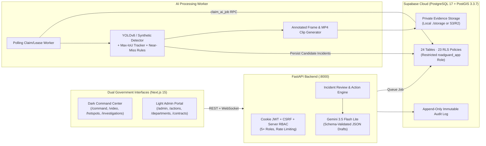

# ROADGUARD AI (Nagar-Setu) — Hackathon Winning Demo & Pitch Guide

> **Core Positioning:** *Other AI projects stop at a bounding box on a video. Nagar-Setu bridges computer vision, spatial road-asset attribution, and government accountability—turning raw traffic footage into legally auditable corrective actions.*

---

## 1. System Architecture



---

## 2. The 3-Minute "Judge-Proof" Live Demo Script

Open **[http://localhost:3000/login](http://localhost:3000/login)** before your turn so you start directly inside the app—skip long slide intros.

### Minute 0:00–0:30 — The Hook & Dual-Portal Entry
- **Action:** Click `ops@demo.roadguard.ai` (1-click autofill) and sign in to the **Dark Command Center** (`/command`).
- **Say:** *"Cities already have thousands of CCTV and dashcam feeds, yet potholes, signal failures, and near-misses repeat at the exact same junctions. Why? Because video detection is completely disconnected from municipal repair workflows and contractor accountability."*

### Minute 0:30–1:30 — Live AI Video Detection & Evidence (`/video` → `/incidents`)
- **Action:** Open **Video Ingestion (`/video`)** and inspect a processed feed (or upload the sample demo clip to show live `queued → running → succeeded` progress). Open a detected **Near-Miss / Hazard Incident**.
- **Point out:** Annotated bounding-box frame, extracted evidence clip, confidence score, and recorded limitations.
- **Say:** *"Every AI detection is treated as an unverified candidate requiring human review—complete with cryptographic SHA-256 checksums on evidence clips."*

### Minute 1:30–2:15 — Spatial Attribution & Gemini Investigation (`/hotspots` → `/investigations`)
- **Action:** Open **Hotspots (`/hotspots`)** to show PostGIS spatial clustering, then open an **Investigation (`/investigations`)** and trigger **AI Analysis**.
- **Point out:** Gemini (`gemini-3.5-flash-lite`) generating structured observed facts, unverified root-cause hypotheses, missing evidence, and recommended actions.
- **Say:** *"We don't let an LLM hallucinate or declare legal fault. Gemini is locked to a strict JSON schema, labels every hypothesis as unverified, and links the PostGIS location directly to the responsible municipal department and active maintenance contract."*

### Minute 2:15–3:00 — Accountability & Tamper-Proof Governance (`/actions` → `/audit`)
- **Action:** Switch to the **Light Administrative Portal (`/actions`)**, show the assigned corrective action for `engineer@demo.roadguard.ai`, and open the **Audit Log (`/audit`)**.
- **Say:** *"Every approval, assignment, and status change writes to an append-only PostgreSQL audit table. Even an organization admin cannot alter or delete past evidence, and 23 Row-Level Security policies isolate every city tenant at the database layer."*

---

## 3. Top Judge Questions & Crisp Answers

| Judge Question | Winning Answer |
| :--- | :--- |
| **"How do you prevent AI hallucinations from blaming the wrong contractor or driver?"** | *"AI never makes final decisions. Both the CV pipeline and Gemini output are marked as unverified drafts with explicit limitations. A human reviewer must approve every incident and corrective action."* |
| **"How do you handle privacy / PII in public CCTV feeds?"** | *"Evidence storage is private behind signed short-lived URLs, the LLM only receives structured metadata (never faces or license plates), and raw video retention windows are enforced via configuration."* |
| **"What happens if an admin tries to cover up an incident?"** | *"Our `audit_logs` table is append-only at the database layer, and the API connects as a restricted non-superuser role (`roadguard_app`) with 23 PostgreSQL Row-Level Security policies."* |
| **"Can this run on real traffic footage, not just demos?"** | *"Yes. The detector is pluggable (`DETECTOR_BACKEND=synthetic_scene` for deterministic CI/testing, or `DETECTOR_BACKEND=yolo` with Ultralytics YOLOv8 + Max-IoU tracking for real intersection video)."* |

---

## 4. Pre-Demo Launch Checklist (3 Terminals)

Run all three before stepping up to present:

```powershell
# Terminal 1 — FastAPI Backend
uvicorn app.main:app --app-dir apps/api --port 8000

# Terminal 2 — Background AI Video Worker
$env:PYTHONPATH="ai-engine;apps/api"; python -m ai_engine.workers.polling_worker --loop --interval 2

# Terminal 3 — Next.js Frontend
pnpm --filter @roadguard/web dev
```

- **Login URL:** `http://localhost:3000/login`
- **Demo Password:** `RoadguardDemo#2026` (or click any role on the login page to autofill)
- **Backup Rule:** Record a 60-second 1080p walkthrough video before going on stage in case venue Wi-Fi drops.
