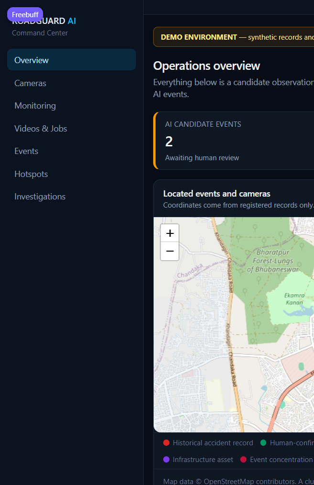
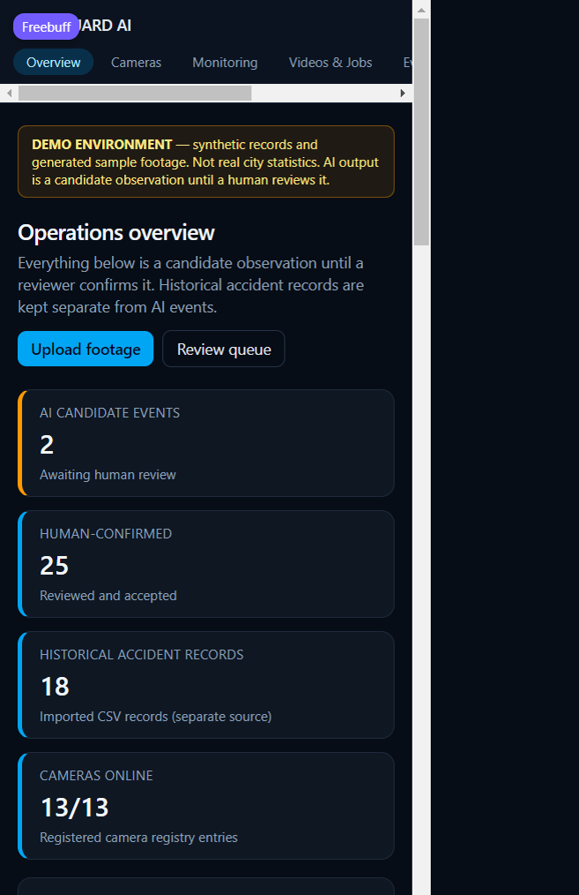

# Visual Regression Report

## Tooling

Chromium via the Freebuff preview panel. Playwright and axe are **not installed** in this
workspace, so the requested 4-viewport automated matrix did not run. `preview_resize` was used
to set CSS viewports.

## Screenshots

| File | Route | Requested viewport | Measured PNG |
| --- | --- | --- | --- |
| `screenshots/command-desktop-1440.png` | `/command` | 1440 × 900 | 657 × 1014 |
| `screenshots/command-mobile-390.png` | `/command` | 390 × 844 | 657 × 1014 |

The capture surface reports a fixed panel size regardless of the configured viewport, so the
PNG dimensions are not the requested ones. Both screenshots were taken **before** the B-002
camera-metric fix, so they still show `13/13`; the live page now shows `0/14`. The **layout inside** the capture does respond: the
desktop shot shows the persistent sidebar, the mobile shot shows the stacked single-column
layout with a horizontally scrolling nav strip. Treat these as visual evidence at panel size,
not as a substitute for a 1440/1366/768/390 matrix.

## Observed

| Check | Result |
| --- | --- |
| Dark command theme | Correct: near-black background, sky accents, amber DEMO banner |
| Light admin theme | Correct: white cards, slate text, same DEMO banner |
| Sidebar → mobile nav | Collapses to a horizontal scroller; all seven items reachable by scrolling |
| Card stacking at 390 | Single column, full-width, no clipping of text |
| Horizontal page overflow | None observed; the scrollbar under the mobile nav belongs to the nav strip, not the page |
| Table overflow | Tables are horizontally scrollable containers; long values did not push the page wider |
| Map | Leaflet tiles load (OSM 200), zoom controls present, legend readable |
| Broken images | None; no 404s in the network log |
| Console errors | None after navigation (the login page's two 401 probes are the session bootstrap) |
| Font/spacing consistency | No misalignment seen on the four pages opened |
| Contrast | Not measured; no automated colour-contrast check ran |

## Not verified

- 1366×768 and 768×1024 breakpoints.
- Modals, dropdowns, date pickers and upload dialogs at any viewport.
- Screenshots for the remaining 20 routes.
- Pixel-diff regression baselines (no baseline set exists).

These are recorded as **BLOCKED/NOT RUN**, not passed.
